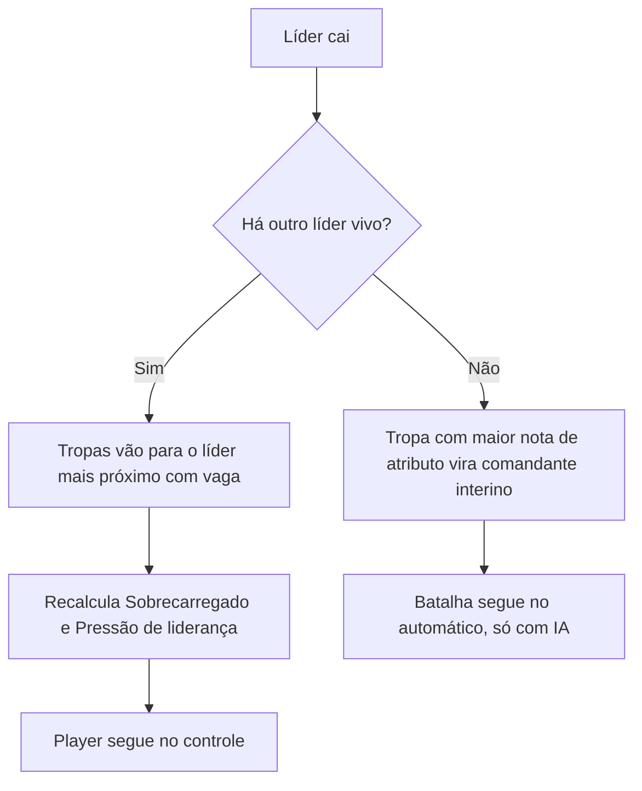

# Design de combate: líderes, pelotões e ordens

Documento vivo do combate de *Vale do Sal*. Versão 0.5, de 2 de novembro de 2026.

Ele registra o que o chefe (Kauê) já decidiu e propõe como preencher o que ainda falta. **As fases 1 e 2 estão implementadas** (veja a [seção 11](#11-ponte-com-o-protótipo-atual)): líderes, subclasses, pelotões, nota de atributo, mapa maior com câmera, batalha de teste de 20 contra 20, ordens gritadas (o player escreve a ordem e o jogo lê), IA de tropa seguindo ordens, IA de ordens do líder inimigo e comandante interino.

## Como ler este documento

Cada seção separa três coisas:

- **Decidido**: regra que veio do chefe. Só muda se ele mudar.
- **Proposta**: sugestão para fechar uma lacuna. Vale como ponto de partida até o chefe confirmar ou trocar.
- **Em aberto**: pergunta que precisa de resposta. A lista completa, já com uma proposta para cada, está na [seção 12](#12-perguntas-em-aberto).

Todo número marcado como proposta serve só para começar a testar. O balanceamento fica para depois, por decisão do chefe.

## Resumo

- O player não comanda uma companhia de mercenários. Ele comanda uma **facção** recém-criada, liderada pelo **Líder Supremo** (o personagem dele) e por outros **líderes**.
- O Líder Supremo **normalmente fica fora das batalhas**: se ele morrer, a campanha acaba. O player manda os outros líderes, e o Supremo só entra em campo como **último recurso**.
- Em combate, o player controla **só os líderes**. As **tropas** agem por IA e seguem as **ordens** do líder do seu **pelotão**.
- A conta ideal é **1 líder para cada 20 tropas**. Tropa demais deixa o líder **Sobrecarregado**. Líder sobrando coloca as tropas sob **Pressão de liderança**.
- O líder **grita as ordens**: o player escolhe o grupo e escreve a ordem numa caixa de texto, e o jogo lê o que ele escreveu. As ordens custam **PL** (pontos de liderança), só chegam a quem está no **alcance** e valem até serem trocadas. Elas só dão bônus depois de **assentar** por um turno inteiro; trocar antes disso causa **estresse** nas tropas.
- Fora de combate, o pelotão age **todo de uma vez**. Quando alguém do grupo ataca ou é atacado, o grupo passa a agir **um por um, por iniciativa**.
- Até **100 tropas por lado**. O inimigo segue as mesmas regras, com líderes dele.
- A meta da IA é ser **melhor que a de *Battle Brothers***, medida por testes automáticos (veja a [seção 10](#10-ia)).
- A base tática segue o gênero de *Battle Brothers* (hexágonos, pontos de ação, fadiga, atributos, traços, moral, zona de controle), com regras, nomes e números próprios. É inspiração, não cópia.

## 1. Visão e escopo

**Decidido**

- A facção começa pequena no mundo e cresce. Os combates são maiores que os de um bando de mercenários, com várias tropas em campo.
- O combate segue o estilo tático por turnos em hexágonos, com atributos e traços por combatente.
- Fica para depois: balanceamento fino, perks e habilidades das tropas.

## 2. Glossário

| Termo | Significado |
| --- | --- |
| Facção | O lado do player na campanha. |
| Líder Supremo | O personagem do player. É um líder, mas normalmente fica fora das batalhas, porque a morte dele encerra a campanha. |
| Líder | Combatente controlado pelo player. Tem subclasse, PA, PL e alcance de comando. Luta em campo. |
| Subclasse | Combate, Estratégico ou Encorajador. Define atributos e força das ordens do líder. |
| Tropa | Combatente comum, controlado pela IA. Tem atributos e traços. |
| Pelotão | Um líder e as tropas atribuídas a ele. |
| Guerreiros e arqueiros | As duas divisões do pelotão para receber ordens. Arqueiros são as tropas com arco ou besta. Guerreiros são o resto. |
| Ordem | Comando que o líder grita: o player escolhe o grupo e escreve a ordem. Vale até ser trocada. |
| PL (pontos de liderança) | Recurso que paga as ordens, do mesmo jeito que os PA pagam movimento e ataque. |
| Alcance de comando | Distância máxima, em hexágonos, entre o líder e a tropa para a ordem chegar. |
| Assentar | A ordem assenta quando passa um turno inteiro sem ser trocada. Só a ordem assentada dá bônus. |
| Ordem repentina | Ordem nova que troca outra que ainda não assentou. |
| Estresse | Debuff de quem recebe uma ordem repentina: menos ataque e menos defesa. Dura 1 turno. |
| Sobrecarregado | Status do líder com mais de 20 tropas. |
| Pressão de liderança | Status das tropas quando há líderes sobrando. |
| Nota de atributo | Soma de todos os atributos de um combatente. |
| Comandante interino | Tropa com a maior nota de atributo, que assume quando não sobra nenhum líder. Só a IA controla. |
| Grupo | O pelotão, quando o assunto é a ordem dos turnos. |
| Contato | Momento em que alguém do grupo ataca ou é atacado, corpo a corpo ou à distância. |
| Rodada | Período em que todos agem uma vez. Um "turno" de ordem equivale a uma rodada. |

## 3. Facção e líderes

**Decidido**

- O Líder Supremo é o personagem do player. Os outros líderes da facção têm uma subclasse cada.
- O Líder Supremo normalmente **não participa das batalhas**. Se ele morrer, o player **perde a campanha**. Por isso o player escolhe quais líderes mandar para cada batalha, e o Supremo só entra em campo como **último recurso**.
- Os líderes lutam em campo, como qualquer combatente.
- Três subclasses por enquanto:
  - **Líder de Combate**: atributos acima do padrão e habilidades para fortalecer aliados próximos.
  - **Líder Estratégico**: atributos abaixo do padrão e habilidades de fortalecimento elevadas.
  - **Líder Encorajador**: atributos no padrão e habilidades de fortalecimento no nível padrão.

**Proposta**

"Padrão" quer dizer a média de atributos de uma tropa comum.

| Subclasse | Atributos | Potência das ordens | PL por turno | Alcance de comando |
| --- | ---: | ---: | ---: | ---: |
| Combate | +20% | ×1,0 | 6 | 5 hex |
| Estratégico | −15% | ×1,5 | 12 | 9 hex |
| Encorajador | padrão | ×1,0 | 9 | 7 hex |

- A **potência** multiplica os bônus das ordens. Exemplo: se "Formar linha defensiva!" dá +10 de defesa corpo a corpo, com o Estratégico ela dá +15.
- O alcance curto do Líder de Combate combina com "fortalecer aliados próximos": ele comanda de dentro da linha de frente.
- Nesta fase, a função do líder em combate é dar ordens. As habilidades próprias de cada subclasse (auras, gritos de guerra, efeitos de moral) ficam para uma fase seguinte.
- **Líder Supremo em campo**: se ele morrer, a batalha termina na hora em derrota e a campanha acaba, mesmo que o resto do exército esteja vencendo. Fugir do campo não conta: ele sobrevive e a batalha segue com os outros líderes.
- **Escolha dos líderes**: na tela de preparação (fase 4), os outros líderes aparecem primeiro. O Supremo fica separado, com um aviso do risco, e pede confirmação para entrar. O player pode levá-lo mesmo assim, mas o jogo nunca o coloca em campo sozinho.
- A mesma regra vale para o inimigo: se um líder supremo inimigo cair em batalha, o lado dele perde na hora. Isso abre espaço para batalhas decisivas na campanha.
- A batalha de teste "Campo das Salinas" usa um líder comum, Duarte (Líder de Combate), e não o Supremo.

**Em aberto**: se o Líder Supremo tem subclasse própria (pergunta 1) e se ele pode ser escolhido quando ainda há outros líderes disponíveis (pergunta 20).

## 4. Tropas

**Decidido**

- Cada tropa tem suas características, atributos e traços. Habilidades das tropas ficam para depois.
- **Nota de atributo** é a soma de todos os valores dos atributos.

**Proposta**

- Os atributos são os oito que o protótipo já usa: Vida, Fadiga máxima, Determinação, Iniciativa, Ataque corpo a corpo, Ataque à distância, Defesa corpo a corpo e Defesa à distância.
- A nota soma os valores base desses oito, sem equipamento e sem ferimentos. Empate: vence a maior Determinação, depois quem está mais perto do líder que caiu.
- Observação: a soma simples favorece quem tem Vida, Fadiga e Iniciativa altas, porque esses números são maiores que os de defesa. Se o comandante escolhido parecer estranho nos testes, dá para usar pesos depois.
- A divisão (guerreiro ou arqueiro) depende da arma na mão no momento da ordem.
- Os traços mudam atributos e também o comportamento da IA. Exemplos: um "Disciplinado" segura melhor a formação, um "Cabeça-dura" obedece com atraso. A lista de traços fica para outro documento.
- **Escudo**: quem luta com arma de uma mão (maça, lâmina) carrega escudo. Lança, arco e as armas dos líderes são de duas mãos, sem escudo. O escudo importa para "Levantar escudos!".

## 5. Pelotões e a regra de 1 líder para 20 tropas

**Decidido**

- Antes da batalha, o player distribui as tropas entre os líderes.
- Durante a batalha, ele pode transferir tropas para outro líder, com uma pequena queda na moral das tropas.
- A proporção ideal é 1 líder para cada 20 tropas: 20 tropas para 1 líder, 40 para 2, e assim por diante.
- **Sobrecarregado**: um líder com mais de 20 tropas perde moral e sofre um pequeno debuff nos atributos de combate e defesa. As tropas dele também perdem um pouco de moral.
- **Pressão de liderança**: quando há líderes sobrando (por exemplo, 2 líderes para menos de 20 tropas), cada tropa sofre um pequeno debuff nos atributos.
- O inimigo segue a mesma regra.

**Proposta**

- **Sobrecarregado** é medido por pelotão: o líder fica sobrecarregado quando o pelotão dele tem mais de 20 tropas vivas em campo.
- **Pressão de liderança** é medida pelo lado inteiro: há pressão quando o número de líderes em campo passa do número de tropas do lado dividido por 20, arredondado para cima. Exemplos:
  - 15 tropas e 2 líderes: precisa de 1, tem 2, então há pressão.
  - 40 tropas e 2 líderes: equilíbrio.
  - 41 tropas e 2 líderes: sem pressão, mas um dos pelotões fica com 21 e o líder dele fica sobrecarregado.
- Efeitos iniciais:

| Status | Quem sofre | Efeito proposto |
| --- | --- | --- |
| Sobrecarregado | O líder | −10 de Determinação e −10% em ataque e defesa (corpo a corpo e à distância) |
| Sobrecarregado | As tropas do pelotão | −5 de Determinação |
| Pressão de liderança | Cada tropa do lado | −5% em ataque e defesa (corpo a corpo e à distância) |

- Nesta fase o efeito é fixo: 25 tropas pesam o mesmo que 21.
- Quando recalcular:
  - Sobrecarga: no início de cada rodada, contando as tropas vivas. Perder tropas pode tirar o líder da sobrecarga.
  - Pressão: só no posicionamento, em transferências e quando um líder cai. Assim, perder tropas no meio da luta não castiga o lado duas vezes.
- **Transferência em batalha**: custa 3 PL do líder que recebe e pode levar várias tropas de uma vez, desde que estejam no alcance de comando dele. Só as tropas transferidas sentem a queda de moral: cada uma faz um teste de moral leve (+20 na chance de resistir) e, se falhar, cai um nível. A tropa transferida continua cumprindo a ordem que já tinha até o novo líder dar outra.

## 6. Ordens gritadas

**Decidido**

- No turno do líder do player, o botão **Dar ordens** abre primeiro a escolha de **para quem** vai a ordem: guerreiros, arqueiros ou todos. Depois abre uma **caixa de texto** em que o player escreve a ordem, como se o líder estivesse gritando no meio da batalha. Exemplo do chefe: escolher os arqueiros e escrever "Arqueiros, preparar disparo!".
- Quem lê a ordem é um **leitor próprio do jogo**, sem serviço externo. Ele entende **vários tipos de ordem**, com sinônimos e jeitos diferentes de dizer a mesma coisa.
- Se o jogo **não entender** a ordem, seja por ela ser complexa demais, seja por estar escrita errado, ele **avisa e devolve o PL**.
- Ordens consomem **PL**, como se fossem PA.
- Não há recarga fixa: o líder pode dar ordens em sequência, e as tropas seguem a ordem até ela ser trocada.
- A ordem precisa **assentar**: passar **um turno inteiro sem ser substituída**. Só a ordem assentada dá bônus de atributo.
- Trocar uma ordem antes de ela assentar é uma **ordem repentina**. Ela causa **estresse** nas tropas, e a ordem trocada não chega a dar o bônus. No exemplo do chefe, "Arqueiros, preparar disparo!" num turno e "Arqueiros, procurem terreno elevado!" no turno seguinte estressa os arqueiros, e eles não ganham o bônus de longo alcance, porque não ficaram nem 2 turnos na posição, mirando.
- O **estresse** é um debuff na **precisão e na defesa**: fica mais difícil acertar e desviar. Quanto mais estresse, mais forte o debuff. Ele dura **1 turno**.
- A ordem tem alcance limitado. A tropa fora do alcance não ouve a ordem nova e continua cumprindo a última ordem que recebeu do seu líder de pelotão.

### Lista de ordens

As sete primeiras vieram do chefe. As seis últimas são proposta, para o leitor entender os gritos mais comuns de uma batalha. Os números são proposta. A **marca** é a letra que aparece no ombro da tropa que segue a ordem.

| Ordem | Marca | Para quem | Efeito | Números propostos | PL |
| --- | :---: | --- | --- | --- | ---: |
| Avanço devagar | D | todos, guerreiros ou arqueiros | Avançam com cuidado. | Andam no máximo 2 hex por turno, mantendo a formação e guardando PA para atacar. | 2 |
| Avanço rápido | R | todos, guerreiros ou arqueiros | Avançam depressa. | Gastam os PA para fechar a distância. A formação fica solta. | 3 |
| Formar linha defensiva | L | todos ou guerreiros | Aumenta a defesa só corpo a corpo. | +10 de defesa corpo a corpo. As tropas formam uma linha contínua e não saem dela. | 3 |
| Levantar escudos | E | todos ou guerreiros | Aumenta a defesa corpo a corpo e à distância. | +8 de defesa corpo a corpo e +8 à distância, só para quem tem escudo. | 4 |
| Disparar | T | arqueiros | Arcos e bestas atiram nos inimigos mais próximos. | Sem bônus. | 2 |
| Preparar disparo | M | arqueiros | Ficam mirando e ganham pontos na habilidade à distância. | +15 de ataque à distância no tiro mirado. | 3 |
| Atacar | A | todos, guerreiros ou arqueiros | Atacam os inimigos mais próximos, com bônus no primeiro ataque. | +10 de ataque no primeiro ataque de cada tropa depois que a ordem assenta. | 4 |
| Manter posição | S | todos, guerreiros ou arqueiros | Param onde estão. | Sem bônus. É o mesmo comportamento de quem está sem ordem. | 1 |
| Recuar | V | todos, guerreiros ou arqueiros | Abrem distância do inimigo. | Sem bônus. Evitam dar ataque grátis e não saem do alcance do líder. | 3 |
| Flanquear | F | todos ou guerreiros | Contornam a linha e atacam quem já está ocupado com um aliado. | Sem bônus próprio: ganham o bônus de cerco que já existe. | 4 |
| Proteger o líder | P | todos, guerreiros ou arqueiros | Fecham em volta do líder e batem em quem chegar perto dele. | Sem bônus. | 3 |
| Cessar fogo | C | arqueiros | Param de atirar e ficam onde estão. | Sem bônus. Serve quando os aliados já estão colados no inimigo. | 1 |
| Procurar terreno elevado | H | todos, guerreiros ou arqueiros | Sobem para o ponto mais alto ao alcance. | Depende do relevo, que ainda não existe. Hoje o jogo avisa que o campo é plano e devolve o PL. | 3 |

Algumas ordens aceitam um **alvo preferido** dito no grito: "Ataquem o líder!", "Mirem nos arqueiros!", "Acabem com os feridos!". Valem para Avanço rápido, Disparar, Preparar disparo, Atacar e Flanquear. Os alvos possíveis são o líder inimigo, os arqueiros inimigos e os feridos. A tropa dá mais peso a esses alvos, sem largar uma jogada muito melhor.

### Como gritar (proposta)

| Ordem | Exemplos que o jogo entende |
| --- | --- |
| Avanço devagar | "Avancem devagar!", "Avancem!", "Em frente, com cuidado!", "Marchem!" |
| Avanço rápido | "Avancem rápido!", "Corram!", "Depressa, avancem!" |
| Formar linha defensiva | "Formar linha defensiva!", "Segurem a linha!", "Em formação!", "Defendam!" |
| Levantar escudos | "Levantar escudos!", "Escudos!", "Parede de escudos!", "Cubram-se!" |
| Disparar | "Disparem!", "Fogo!", "Atirem à vontade!", "Soltem as flechas!" |
| Preparar disparo | "Preparar disparo!", "Mirem!", "Apontar!", "Mirem no líder deles!" |
| Atacar | "Ataquem!", "Carga!", "Pra cima deles!", "Matem o líder!" |
| Manter posição | "Mantenham a posição!", "Alto!", "Fiquem onde estão!", "Não avancem!" |
| Recuar | "Recuem!", "Para trás!", "Retirada!", "Afastem-se!" |
| Flanquear | "Pelos flancos!", "Flanqueiem!", "Cerquem eles!" |
| Proteger o líder | "Protejam o líder!", "Comigo!", "A mim!", "Reagrupem!" |
| Cessar fogo | "Cessar fogo!", "Segurem o fogo!", "Não atirem!" |
| Procurar terreno elevado | "Procurem terreno elevado!", "Subam a colina!", "Tomem o morro!" |

### Como o jogo lê a ordem (proposta)

- **Acentos, maiúsculas e pontuação não importam.** Letras repetidas viram uma só ("Avançeeem!!!" vira "avancem").
- **Erros de digitação pequenos passam**: nenhum em palavras de até 3 letras, 1 em palavras de 4 a 7 letras e 2 a partir de 8. Letras trocadas de lugar contam como um erro só ("dispraem" vira "disparem"). Palavras comuns que não são ordem ("minha", "tipo", "parte") nunca são confundidas com ordens parecidas ("linha", "tiro", "pare").
- **Formas do verbo**: o jogo reconhece o começo das palavras, então "avancem", "avançando" e "avançai" são a mesma ordem.
- **Quem é chamado**: o grupo dito antes do verbo ("Arqueiros, ...") é quem ouve. Se o player escolheu "todos" e gritou "Arqueiros, disparem!", só os arqueiros ouvem. Se escolheu os guerreiros e gritou "Arqueiros, ...", o jogo avisa da contradição e devolve o PL. Depois do verbo e de um artigo, o grupo vira alvo: "Ataquem os arqueiros!".
- **Negação**: só vale para parar algo. "Não avancem" e "ninguém se mexe" viram Manter posição. "Não atirem" vira Cessar fogo. "Não recuem" vira Manter posição. Outras negações ("não defendam") são confusas demais para o meio da batalha.
- **O que o jogo não entende** (e devolve o PL):
  - Grito sem nenhuma ordem conhecida. Se uma palavra parece uma ordem mal escrita, o aviso sugere a certa ("Você quis dizer 'disparem'?").
  - Duas ordens diferentes de uma vez ("Avancem e recuem!"). O aviso diz o que as tropas ouviram.
  - Condições ("se", "quando", "caso", "assim que"): "Se eles chegarem, ataquem" é complexo demais.
  - Grito com mais de 12 palavras, sem contar o grupo chamado. A caixa aceita até 90 letras.
  - Ordem que não vale para o grupo ("Arqueiros, levantar escudos!"), sem tropa do grupo no alcance, ou que todas as tropas no alcance já cumprem.
- **Palavras que reforçam a mesma ordem** se juntam numa só: "Avancem e ataquem!" é Atacar; "Segurem a linha com os escudos!" é Levantar escudos.
- O texto escrito pelo player é o que aparece no balão de fala do líder e no registro de combate.

### Assentar e estresse (proposta)

- **Quando assenta**: a ordem dada na rodada R passa pelo resto da rodada R e pela rodada R+1 inteira. Ela assenta no começo da rodada R+2 e dá o bônus a partir daí. Exemplo: "Preparar disparo!" na rodada 1 deixa os arqueiros mirando nas rodadas 1 e 2; na rodada 3 eles atiram com +15.
- O **comportamento** vale na hora. Só o **bônus** espera assentar.
- **Repetir a mesma ordem** não reinicia a contagem e não estressa. Mudar só o alvo ("Ataquem!" e depois "Ataquem o líder!") também não: é um ajuste. Os dois custam o PL da ordem.
- **Quem fica sob estresse**: só as tropas no alcance que ouvem a ordem nova e cuja ordem anterior ainda não tinha assentado. Quem estava sem ordem, ou com a ordem já assentada, não se estressa.
- **Força**: cada nível tira **5 de ataque e 5 de defesa**, corpo a corpo e à distância, até o nível 4 (−20). A primeira ordem repentina dá nível 1. Trocar de novo antes de assentar soma um nível. Quando uma ordem assenta, a conta volta a zero.
- **Duração**: o estresse vale até o fim do próximo turno da tropa. Se ela ainda não agiu na rodada, acaba no fim do turno dela nesta rodada; se já agiu, no fim do turno da rodada seguinte.
- **A ordem não vence**: as tropas seguem a última ordem até o líder dar outra. A tropa fora do alcance segue a última que ouviu, com o bônus se ela já tinha assentado.
- **PL**: renova a cada turno do líder, como os PA. O que sobra não acumula.
- **Dar ordem não gasta PA**. O líder pode gritar e ainda andar ou atacar no mesmo turno.
- **Ordem para "todos"** custa o mesmo PL que para uma divisão só.
- **Alcance**: conta a distância em hexágonos entre o líder e a tropa no momento da ordem. Não precisa de linha de visão.
- **Atacar**: o bônus vale no primeiro ataque que a tropa faz por vontade própria depois que a ordem assenta. Ataques de reação (zona de controle) não usam nem gastam o bônus.
- **Preparar disparo**: a tropa mira enquanto a ordem assenta e não atira, para não desperdiçar a mira. Depois, todos os tiros no alvo mirado ganham o bônus (até 2 por turno, por causa dos PA). Andar perde a mira. Se o alvo cair, fugir ou sair da linha de tiro, o arqueiro mira em outro.
- **Na tela**: a letra no ombro da tropa fica apagada enquanto a ordem assenta e ganha um "!" laranja quando a tropa está sob estresse. A aba de comando mostra, para guerreiros e arqueiros, a ordem atual, se ela já assentou (ou em que rodada assenta) e quantas tropas estão sob estresse.
- **Prévia enquanto escreve**: embaixo da caixa, o jogo mostra o que as tropas estão entendendo, o custo, quantas tropas vão ouvir e quantas vão ficar sob estresse. Também mostra o aviso antes de gritar, quando a ordem não vai ser entendida. Se o chefe preferir mais tensão, dá para tirar a prévia e só avisar depois do grito.
- **Quem dá ordens**: o líder do pelotão ou, sem nenhum líder vivo no lado, o comandante interino. O líder em fuga não dá ordens até recobrar a coragem.
- **Líderes da IA** escolhem a ordem pelas regras da seção 10.3 e só trocam uma ordem depois que ela assenta, então nunca estressam as próprias tropas. Eles gritam a forma padrão ("Guerreiros, formar linha defensiva!"). Por enquanto usam só as sete ordens originais.
- **Tiro por cima e flecha perdida** (decidido pelo chefe): flechas passam por cima de quem estiver no caminho, aliado ou inimigo; só obstáculos bloqueiam a linha de tiro. Se a flecha errar e houver aliados do atirador em contato com o alvo, ela pode acertar um deles: 35% por aliado em contato, no máximo 70%, sorteando qual. Corpo a corpo nunca se perde assim. A ficha do alvo e a dica do mouse mostram a chance de acertar um aliado; a IA pesa esse risco e pode decidir não atirar.
- **Sem pelotão**: combatentes sem pelotão (só existem no encontro antigo de 3 contra 4, usado nos testes) lutam por conta própria, avançando e atacando.

### Como a IA cumpre cada ordem (proposta)

| Ordem | O que a tropa tenta fazer | O que ela evita | Quando não dá |
| --- | --- | --- | --- |
| Avanço devagar | Chegar mais perto do inimigo sem abrir buraco na linha. Ataca se começar o turno colada num inimigo. | Sair de zona de controle inimiga, passar à frente dos vizinhos. | Segura a posição. |
| Avanço rápido | Chegar o mais perto possível do inimigo mais próximo do pelotão e atacar se alcançar. | Parar no meio do caminho com PA sobrando. | Anda o que der. |
| Formar linha defensiva | Ocupar uma vaga na linha virada para o inimigo e atacar quem chegar ao lado. | Avançar além da linha ou perseguir. | Tapa o buraco mais próximo da linha. |
| Levantar escudos | Ficar no lugar e atacar só quem estiver colado. | Andar mais de 1 hex. | Fica parada. |
| Disparar | Atirar no inimigo que mais vale a flecha ao alcance, por cima de quem estiver no caminho. Se ninguém estiver no alcance, andar até ter alguém. Segura o tiro quando um aliado está em contato com o alvo e o risco de acertá-lo pesa mais que o tiro. | Ficar colada num inimigo corpo a corpo. | Se estiver engajada, recua 1 hex quando isso não der ataque grátis ao inimigo. |
| Preparar disparo | Mirar sem atirar enquanto a ordem assenta. Depois, atirar com o bônus no alvo mirado. | Andar, porque andar perde a mira. | Se o alvo sumir, mira no novo inimigo mais próximo. |
| Atacar | Atacar o inimigo mais próximo. Guerreiros andam até ele. | Trocar de alvo sem motivo. | Anda em direção ao inimigo mais próximo. |
| Manter posição | Ficar no lugar e atacar quem estiver colado. Arqueiros atiram no que estiver ao alcance. | Andar. | Fica parada. |
| Recuar | Abrir distância do inimigo, sem sair do alcance do líder. | Sair de zona de controle dando ataque grátis. | Fica no lugar e se defende. |
| Flanquear | Contornar e atacar o inimigo que já está colado num aliado, para somar o bônus de cerco. | Bater de frente num inimigo livre. | Avança em direção ao inimigo. |
| Proteger o líder | Ficar colada no líder e atacar quem chegar perto dele. | Se afastar do líder para perseguir. | Anda em direção ao líder. |
| Cessar fogo | Ficar no lugar sem atirar. | Atirar, mesmo com alvo bom. | Fica parada. |
| Procurar terreno elevado | Subir ao ponto mais alto ao alcance. | (Depende do relevo.) | Hoje não pode ser dada: o campo é plano. |

O alvo preferido dito no grito ("o líder", "os arqueiros", "os feridos") pesa 1,5 vez na escolha do alvo.

**Sem ordem** (no começo da batalha), as tropas ficam em Manter posição sem custo de PL.

## 7. Morte do líder e sucessão

**Decidido**

- Se o líder morre, as tropas dele passam para outro líder, se houver. A regra de 20 por líder continua valendo, então o líder que recebe pode ficar sobrecarregado.
- Se não sobra nenhum líder, as tropas passam a seguir a tropa com a maior nota de atributo. Ela não é líder, então o player não pode controlá-la. O resto da batalha fica automático, com a IA tentando tomar as melhores decisões.

**Proposta**

- As tropas vão para o líder vivo mais próximo que ainda tenha vaga (menos de 20 tropas). Se ninguém tem vaga, vão todas para o mais próximo. Depois o player pode redistribuir com as regras normais de transferência.
- A morte do líder causa um teste de moral negativo extra nas tropas do pelotão dele, além do teste normal pela morte de um aliado.
- As tropas herdadas continuam com a ordem que tinham até o novo líder dar outra.
- O **comandante interino** é escolhido entre todas as tropas vivas do lado. Ele dá ordens pela mesma IA dos líderes inimigos, com 6 PL por turno e 5 hex de alcance. Se ele cair, a próxima maior nota assume. (Implementado na fase 2.)
- **Exceção do Líder Supremo**: se quem caiu foi o Supremo, não há sucessão. A batalha termina em derrota na hora (seção 3).
- No modo automático, o player assiste. A tela ganha controles de velocidade e um botão para pular até o resultado.

## 8. Turnos: grupos e iniciativa

**Decidido**

- O líder e o seu grupo agem todos de uma vez.
- Quando qualquer tropa ou líder do grupo entra em combate (atacando ou sendo atacado, corpo a corpo ou à distância), cada membro daquele grupo rola sua iniciativa e passa a agir individualmente.

**Proposta**

- A fila da rodada mistura dois tipos de vez:
  - **Vez de grupo**, para pelotões fora de combate. A posição na fila vem da Iniciativa do líder. O líder age primeiro (ordem, movimento, ataque) e depois as tropas executam a ordem, uma depois da outra, sem parar para o player.
  - **Vez individual**, para membros de grupos em combate. Cada um entra na fila pela própria iniciativa, intercalando aliados e inimigos, como o protótipo já faz.
- **Contato no meio da rodada**: no instante em que alguém do grupo ataca ou é atacado, a vez de grupo se divide em vezes individuais para quem ainda não agiu naquela rodada. Elas entram na fila pela iniciativa. Quem já agiu não age de novo. Isso vale para os dois lados: quem atacou e quem foi atacado.
- **Saída do combate**: se o grupo passa uma rodada inteira sem atacar, sem ser atacado e sem ninguém colado a um inimigo, ele volta a agir em grupo na rodada seguinte.
- **Ordem no modo individual**: o líder dá a ordem na vez dele, e ela vale na hora para quem do pelotão ainda vai agir naquela rodada.
- **Contagem**: o assentamento das ordens e o estresse contam por rodada (seção 6).

## 9. Escala, mapa e desempenho

**Decidido**

- No máximo 100 tropas por lado, por enquanto.

**Proposta**

- 100 tropas e até 5 líderes por lado dão uns 210 combatentes. O tabuleiro atual, de 15×9 (135 hex), não comporta. A sugestão é começar com 48×32 (1.536 hex), com câmera que arrasta e dá zoom.
- Ajustes no motor (`src/game.ts`) para aguentar essa escala:
  - Grade indexada no lugar de `tiles.find`, que hoje percorre o mapa inteiro a cada consulta.
  - Caminho mais curto com fila de prioridade, em vez de ordenar a lista inteira a cada passo.
  - Mapa de distância por pelotão, calculado uma vez por rodada e consultado por todas as tropas dele.
  - Mapa de ameaça por rodada: quais hexágonos estão na zona de controle ou no alcance de arqueiros inimigos.
  - IA rodando num Web Worker, para a tela não travar. O motor já é puro (sem Phaser e sem DOM), então a mudança é direta.
- Animação: a vez de grupo anima as tropas em paralelo. A tela ganha velocidade 1×, 2× e 4× e a opção de pular animações da IA.
- Meta de desempenho: uma rodada inteira da IA, com 200 combatentes, em menos de 1 segundo num notebook comum.

## 10. IA

**Decidido**

- As tropas do player que não são controladas diretamente têm uma IA que tenta seguir as ordens do líder.
- Os líderes inimigos funcionam como os do player e precisam de uma IA boa para tomar decisões decentes.
- A IA tem que ser **superior à de *Battle Brothers***.

**Proposta**

A IA usa as mesmas regras do player e não trapaceia: não vê rolagens futuras e não ganha atributos extras. A dificuldade vem de quão bem ela pensa, não de bônus escondidos. Ela tem três camadas.

### 10.1 Tropa: escolha por pontuação, guiada pela ordem

Na sua vez, a tropa lista as ações possíveis (andar para cada hex alcançável, atacar cada alvo, mirar, esperar, segurar posição) e dá uma nota para cada uma. Ela faz a de maior nota.

`nota = obediência × cumprimento da ordem + valor tático + autopreservação + coesão`

- **Cumprimento da ordem**: quanto a ação realiza o que a ordem pede, conforme a tabela da seção 6. Cada ordem é um perfil de pesos, então criar uma ordem nova é só criar um perfil novo.
- **Valor tático**: chance de acerto, dano esperado em vida e armadura, chance de matar, perigo do alvo (arqueiro solto, líder inimigo) e bônus por cercar. No tiro, desconta o dano esperado da flecha perdida em aliados colados no alvo, pesado 1,5×; se o tiro fica negativo, o arqueiro não atira.
- **Autopreservação**: evitar ataques grátis da zona de controle, evitar ficar cercada, olhar a fadiga e a moral.
- **Coesão**: ficar perto da vaga que o pelotão reservou para ela na formação.
- **Obediência**: vem da moral e dos traços. Uma tropa abalada pode hesitar num "Avanço rápido!". Uma tropa em fuga ignora ordens, como já acontece no protótipo.
- Um ruído pequeno, controlado pela semente, deixa a IA menos previsível sem fazer jogada boba.

### 10.2 Pelotão: coordenação

Antes das tropas agirem, o pelotão monta um plano rápido:

- **Formação**: calcula as vagas (linha virada para o inimigo, arqueiros atrás) e distribui entre as tropas.
- **Divisão de alvos**: evita seis tropas batendo num inimigo que cai com dois golpes e espalha os tiros quando compensa.
- **Ordem de ação dentro da vez de grupo**: quem vai para a frente age primeiro, para não bloquear o caminho de quem vem atrás.

### 10.3 Líder IA (inimigo, comandante interino e modo automático)

Decide as ordens, o movimento do próprio líder e as transferências de tropas.

- Lê a situação em números: força de cada lado perto de cada pelotão, distância até o inimigo, quantos arqueiros cada lado tem, moral média e terreno.
- Avalia cada ordem possível, inclusive "não ordenar agora". Como a ordem leva um turno para assentar, o líder IA decide pensando no que o pelotão vai precisar quando as linhas se encontrarem, e só troca uma ordem depois que ela assenta, para não estressar as tropas:
  - **Versão 1**, regras com pontuação: rápidas e fáceis de ajustar. Exemplo: inimigo longe e com muitos arqueiros leva a "Levantar escudos!" e "Avanço devagar!".
  - **Versão 2**, simulação curta: o motor é determinístico, então dá para copiar o estado, simular 2 ou 3 rodadas para cada ordem candidata, com algumas sementes diferentes, e escolher a que deixa o lado melhor (vida, armadura, moral e posição). Essa versão vira o nível difícil.
- **Estratégia do lado**: escolhe o flanco de cada pelotão, mantém a proporção de 20 por líder, protege os próprios líderes (perder um líder custa caro) e caça os líderes do player.
- **Personalidades**: agressiva, cautelosa e oportunista, mudando os pesos. Facções inimigas diferentes podem ter personalidades diferentes.

### 10.4 A meta: melhor que a de *Battle Brothers*

Não dá para colocar as duas IAs para jogar uma contra a outra, então "melhor" vira uma lista de habilidades que um oponente tático forte precisa mostrar. Cada uma ganha um teste automático, e o chefe confere jogando. Se a IA fizer uma jogada boba numa partida, a situação vira um teste novo.

| # | Habilidade | Como aparece no jogo | Fase |
| ---: | --- | --- | ---: |
| 1 | Concentrar ataques | Prefere terminar um ferido a espalhar golpes. Pesa a chance de matar. | 2 |
| 2 | Não dar ataque grátis | Só sai de uma zona de controle inimiga quando o ganho compensa o risco. | 2 |
| 3 | Escolher o alvo certo | Pesa chance de acerto, dano esperado na vida e na armadura, arqueiros soltos e líderes. | 2 |
| 4 | Cercar | Usa o bônus de cerco e ataca de vários lados. | 2 |
| 5 | Preservar a vida | Tropa ferida ou abalada evita trocas ruins. Arqueiro engajado recua. O líder IA se expõe menos que a tropa. | 2 |
| 6 | Cumprir a ordem do jeito certo | Linha defensiva não persegue, avanço devagar não abre buraco, arqueiros procuram linha de tiro. | 2 |
| 7 | Ficar no alcance do líder | A tropa evita sair do alcance de comando, para não ficar sem notícias. | 2 |
| 8 | Dar a ordem certa na hora certa | Líder IA lê força, distância e arqueiros de cada lado, e combina ordens para guerreiros e arqueiros. | 2 (v1), 5 (v2) |
| 9 | Coordenar o pelotão | Divide alvos e decide quem age primeiro na vez de grupo. | 3 |
| 10 | Pensar no lado inteiro | Escolhe flancos, protege os próprios líderes e caça os do player. | 5 |

A IA nunca trapaceia (seção 10, início). A régua de aprovação:

- **Torneio contra a versão anterior**: exércitos espelhados, trocando de lado, várias sementes. A IA nova precisa vencer com folga dos dois lados para entrar. Na fase 2, a régua é a IA antiga do protótipo (avança e ataca o mais próximo).
- **Testes de comportamento**: um por habilidade da tabela.
- **Teste do chefe**: as partidas do chefe são a prova final.

### 10.5 Como garantir que a IA é boa

- **Torneios automáticos** de IA contra IA nos testes (o `src/game.test.ts` já simula batalhas inteiras): exércitos espelhados, trocando de lado, com centenas de sementes. Mede vitórias, duração e perdas.
- **Testes de comportamento por ordem**, por exemplo: "com Formar linha defensiva!, nenhum guerreiro avança mais de 1 hex" e "com Arqueiros, disparem!, todo arqueiro com alvo na linha de tiro atira".
- **Comparação com a versão anterior**: toda mudança na IA joga contra a anterior e só entra se não piorar.
- **Registro de decisões** no modo de desenvolvimento: mostra por que cada tropa escolheu a ação, com as notas de cada opção.

## 11. Ponte com o protótipo atual

**O que já existe e é reaproveitado**: PA e fadiga, armadura de cabeça e corpo, zona de controle, linha de tiro, moral em 5 níveis, sorteios com semente, fila por iniciativa e a IA simples, que vira o ponto de partida da IA de tropa.

**O que muda no modelo**:

- `Unit` ganha papel (líder ou tropa), subclasse, pelotão, ordem atual e PL.
- `BattleState` ganha pelotões, a última ordem de cada divisão e uma fila com vezes de grupo. `Unit` ganha o estresse.
- O tabuleiro passa a ter tamanho variável.
- O encontro sai do `createBattle` fixo e passa a vir de dados.

**Fases sugeridas**:

1. ✅ Modelo de dados (líder, tropa, pelotão, nota de atributo), mapa maior com câmera e um encontro de teste de 20 contra 20, com 1 líder por lado.
2. ✅ Aba de comando: ordens, PL, recarga, alcance e a IA de tropa seguindo ordens. Entraram também a IA de ordens do líder inimigo (versão 1), o comandante interino e a regra do Líder Supremo (a batalha de teste passou a usar um líder comum). Para o torneio de IA ser justo, a batalha de teste ficou espelhada (mesmo terreno, mesmo bloco de formação dentro dos 5 hex de alcance) e os saqueadores do campo ganharam o cutelo de saque, que bate como a maça. Empates de iniciativa passaram a ser sorteados pela semente, sem favorecer um lado.
   - ✅ **Ordens gritadas** (versão 0.5): a lista de botões com recarga deu lugar à caixa de texto, com o leitor de ordens do jogo (`src/commands.ts`), 13 ordens, alvo preferido, assentamento e estresse.
3. Vez de grupo e passagem para iniciativa no contato.
4. Tela de preparação (escolher os líderes, com o Supremo só como último recurso, e distribuir as tropas), regra de 20 por líder (Sobrecarregado e Pressão de liderança), transferências e sucessão entre líderes.
5. IA de líder versão 2 (simulação), estratégia do lado, escala de 100 contra 100, otimização e Web Worker.
6. Habilidades das subclasses e traços das tropas.

## 12. Perguntas em aberto

Cada pergunta já tem uma proposta. Se o chefe não mudar, a proposta vale.

| # | Pergunta | Proposta |
| ---: | --- | --- |
| 1 | O Líder Supremo tem subclasse própria ou escolhe uma das três? | Escolhe uma das três. |
| 2 | Se o Líder Supremo cair, a batalha acaba em derrota? | **Decidida pelo chefe**: a morte dele encerra a campanha, então ele normalmente fica fora das batalhas. Se estiver em campo e cair, a batalha acaba em derrota na hora. |
| 3 | Sobrecarga e pressão pioram com o tamanho do excesso (25 tropas pior que 21)? | Não nesta fase. Efeito fixo. |
| 4 | A Pressão de liderança aparece quando o lado perde tropas no meio da luta? | Não. Só no posicionamento, em transferências e na morte de um líder. |
| 5 | A recarga é separada por divisão (guerreiros e arqueiros) ou uma só para o líder? | **Decidida pelo chefe**: não há mais recarga. O líder dá ordens quando quiser; trocar uma ordem antes de assentar causa estresse. O assentamento é contado por tropa. |
| 6 | Ordem para "todos" custa mais PL? | Não. Mesmo custo. |
| 7 | Dar ordem também gasta PA? | Não. Só PL. |
| 8 | O alcance de comando precisa de linha de visão? | Não. Só distância. |
| 9 | A tropa fora do alcance segue a última ordem para sempre? | Sim. A ordem não vence mais: a tropa segue a última que ouviu até voltar ao alcance e receber outra. |
| 10 | O que as tropas fazem sem ordem? | Manter posição. |
| 11 | "Levantar escudos!" vale para quem não tem escudo? | Não. Sem escudo, sem bônus. |
| 12 | "Preparar disparo": quando o arqueiro atira com o bônus? | Mira enquanto a ordem assenta e atira com o bônus depois. Andar perde a mira. |
| 13 | "Atacar!": o bônus vale no primeiro ataque da ordem ou no primeiro de cada turno? | Só no primeiro ataque depois que a ordem assenta. |
| 14 | Transferir tropas em batalha custa PL? Quantas por vez? A queda de moral atinge só quem foi transferido? | 3 PL do líder que recebe, várias tropas de uma vez, dentro do alcance dele. Só as transferidas perdem moral. |
| 15 | O comandante interino sofre a regra de 20 por líder? | Não. |
| 16 | Como termina uma batalha de 100 contra 100? Lutar até o último cair é demorado. | Um lado perde quando não tem mais nenhum líder e mais da metade das tropas dele está morta ou em fuga, ou quando o player manda recuar. |
| 17 | A posição do grupo na fila vem da iniciativa do líder ou da média do grupo? | Iniciativa do líder. |
| 18 | Vai ter névoa de guerra? Isso muda bastante a IA. | Não nesta fase. |
| 19 | Arma de arremesso (dardo, machadinha) conta como arqueiro? | Decidir quando essas armas existirem. |
| 20 | O Supremo pode ir para a batalha quando ainda há outros líderes disponíveis? | Pode, com confirmação e aviso do risco. A tela sempre sugere os outros líderes primeiro. |
| 21 | A tropa sem notícias (fora do alcance) mantém o bônus da ordem? | Sim, se a ordem já tinha assentado. Como a ordem não vence mais, a tropa só perde o bônus quando recebe outra ordem. |
| 22 | Quem tem escudo? | Quem usa arma de uma mão (maça, lâmina). Lança, arco e as armas dos líderes não. |
| 23 | Quanto vale o estresse? | −5 de ataque e −5 de defesa por nível, até o nível 4. Cada troca seguida antes de assentar soma um nível. |
| 24 | O player vê o que as tropas entenderam antes de gritar? | Sim: a caixa mostra a ordem entendida, o custo, quem ouve e quem fica sob estresse. Dá para tirar se o chefe quiser mais tensão. |
| 25 | Que ordens além das sete originais o leitor entende? | Manter posição, Recuar, Flanquear, Proteger o líder, Cessar fogo e Procurar terreno elevado (esta espera o relevo). |

## Histórico

- **0.1 (2026-11-01)**: primeira versão, a partir das conversas com o chefe no projeto.
- **0.2 (2026-11-01)**: fase 1 implementada.
- **0.3 (2026-11-01)**: o Líder Supremo fica fora das batalhas e a morte dele encerra a campanha (decisão do chefe). Meta de IA melhor que a de *Battle Brothers*, com a lista de habilidades e a régua de aprovação. Fase 2 implementada.
- **0.4 (2026-11-01)**: arqueiros atiram por cima da linha; flecha que erra pode acertar aliado em contato com o alvo, e a IA segura o tiro quando não compensa (pedido do chefe).
- **0.5 (2026-11-02)**: ordens gritadas no lugar da lista de ordens com recarga (decisão do chefe). O player escolhe o grupo e escreve a ordem; o leitor do jogo entende 13 ordens, sinônimos e erros de digitação, e devolve o PL quando não entende. A ordem vale até ser trocada, só dá bônus depois de assentar por um turno inteiro, e trocar antes disso causa estresse.
