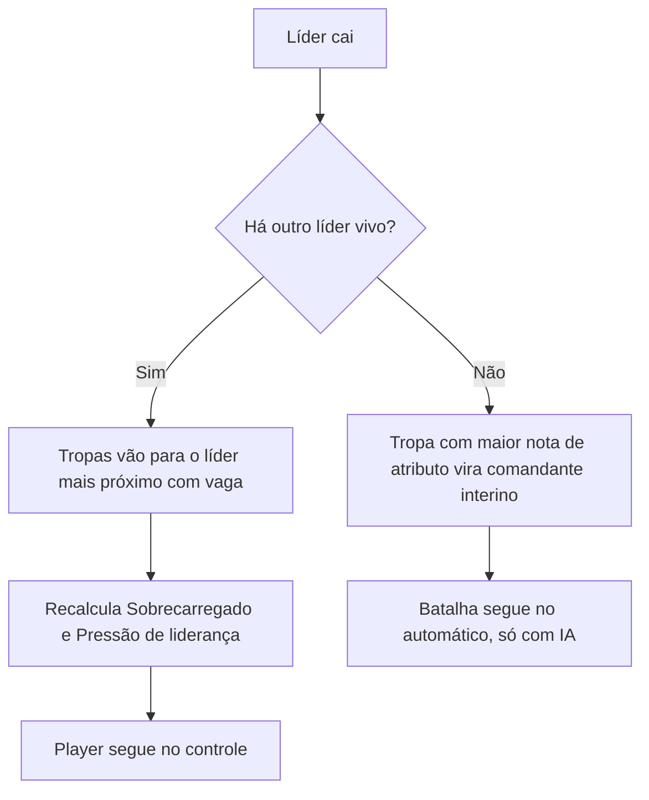
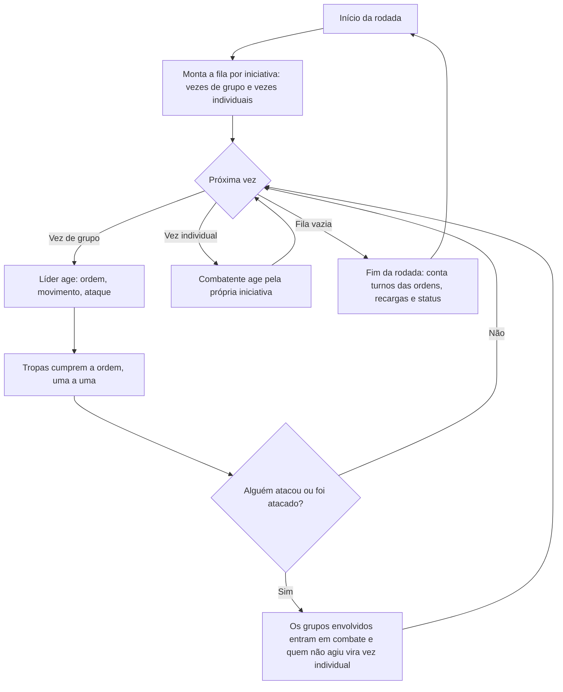

# Design de combate: líderes, pelotões e ordens

Documento vivo do combate de *Vale do Sal*. Versão 0.1, de 1º de novembro de 2026.

Ele registra o que o chefe (Kauê) já decidiu e propõe como preencher o que ainda falta. **Só a fase 1 está implementada** (veja a [seção 11](#11-ponte-com-o-protótipo-atual)): líderes, subclasses, pelotões, nota de atributo, mapa maior com câmera e a batalha de teste de 20 contra 20.

## Como ler este documento

Cada seção separa três coisas:

- **Decidido**: regra que veio do chefe. Só muda se ele mudar.
- **Proposta**: sugestão para fechar uma lacuna. Vale como ponto de partida até o chefe confirmar ou trocar.
- **Em aberto**: pergunta que precisa de resposta. A lista completa, já com uma proposta para cada, está na [seção 12](#12-perguntas-em-aberto).

Todo número marcado como proposta serve só para começar a testar. O balanceamento fica para depois, por decisão do chefe.

## Resumo

- O player não comanda uma companhia de mercenários. Ele comanda uma **facção** recém-criada, liderada pelo **Líder Supremo** (o personagem dele) e por outros **líderes**.
- Em combate, o player controla **só os líderes**. As **tropas** agem por IA e seguem as **ordens** do líder do seu **pelotão**.
- A conta ideal é **1 líder para cada 20 tropas**. Tropa demais deixa o líder **Sobrecarregado**. Líder sobrando coloca as tropas sob **Pressão de liderança**.
- As ordens saem da **aba de comando**, custam **PL** (pontos de liderança), valem por **3 turnos** e só chegam a quem está no **alcance**.
- Fora de combate, o pelotão age **todo de uma vez**. Quando alguém do grupo ataca ou é atacado, o grupo passa a agir **um por um, por iniciativa**.
- Até **100 tropas por lado**. O inimigo segue as mesmas regras, com líderes dele.
- A base tática segue o gênero de *Battle Brothers* (hexágonos, pontos de ação, fadiga, atributos, traços, moral, zona de controle), com regras, nomes e números próprios. É inspiração, não cópia.

## 1. Visão e escopo

**Decidido**

- A facção começa pequena no mundo e cresce. Os combates são maiores que os de um bando de mercenários, com várias tropas em campo.
- O combate segue o estilo tático por turnos em hexágonos, com atributos e traços por combatente.
- Fica para depois: balanceamento fino, perks e habilidades das tropas.

## 2. Glossário

| Termo | Significado |
| --- | --- |
| Facção | O lado do player na campanha. |
| Líder Supremo | O personagem do player. É um líder. |
| Líder | Combatente controlado pelo player. Tem subclasse, PA, PL e alcance de comando. Luta em campo. |
| Subclasse | Combate, Estratégico ou Encorajador. Define atributos e força das ordens do líder. |
| Tropa | Combatente comum, controlado pela IA. Tem atributos e traços. |
| Pelotão | Um líder e as tropas atribuídas a ele. |
| Guerreiros e arqueiros | As duas divisões do pelotão para receber ordens. Arqueiros são as tropas com arco ou besta. Guerreiros são o resto. |
| Ordem | Comando dado pela aba de comando. Vale por 3 turnos. |
| PL (pontos de liderança) | Recurso que paga as ordens, do mesmo jeito que os PA pagam movimento e ataque. |
| Alcance de comando | Distância máxima, em hexágonos, entre o líder e a tropa para a ordem chegar. |
| Recarga | Os 3 turnos em que não dá para dar uma ordem nova. |
| Sobrecarregado | Status do líder com mais de 20 tropas. |
| Pressão de liderança | Status das tropas quando há líderes sobrando. |
| Nota de atributo | Soma de todos os atributos de um combatente. |
| Comandante interino | Tropa com a maior nota de atributo, que assume quando não sobra nenhum líder. Só a IA controla. |
| Grupo | O pelotão, quando o assunto é a ordem dos turnos. |
| Contato | Momento em que alguém do grupo ataca ou é atacado, corpo a corpo ou à distância. |
| Rodada | Período em que todos agem uma vez. Um "turno" de ordem equivale a uma rodada. |

## 3. Facção e líderes

**Decidido**

- O Líder Supremo é o personagem do player. Os outros líderes da facção têm uma subclasse cada.
- Os líderes lutam em campo, como qualquer combatente.
- Três subclasses por enquanto:
  - **Líder de Combate**: atributos acima do padrão e habilidades para fortalecer aliados próximos.
  - **Líder Estratégico**: atributos abaixo do padrão e habilidades de fortalecimento elevadas.
  - **Líder Encorajador**: atributos no padrão e habilidades de fortalecimento no nível padrão.

**Proposta**

"Padrão" quer dizer a média de atributos de uma tropa comum.

| Subclasse | Atributos | Potência das ordens | PL por turno | Alcance de comando |
| --- | ---: | ---: | ---: | ---: |
| Combate | +20% | ×1,0 | 6 | 5 hex |
| Estratégico | −15% | ×1,5 | 12 | 9 hex |
| Encorajador | padrão | ×1,0 | 9 | 7 hex |

- A **potência** multiplica os bônus das ordens. Exemplo: se "Formar linha defensiva!" dá +10 de defesa corpo a corpo, com o Estratégico ela dá +15.
- O alcance curto do Líder de Combate combina com "fortalecer aliados próximos": ele comanda de dentro da linha de frente.
- Nesta fase, a função do líder em combate é dar ordens. As habilidades próprias de cada subclasse (auras, gritos de guerra, efeitos de moral) ficam para uma fase seguinte.

**Em aberto**: se o Líder Supremo tem subclasse e o que acontece quando ele cai (perguntas 1 e 2).

## 4. Tropas

**Decidido**

- Cada tropa tem suas características, atributos e traços. Habilidades das tropas ficam para depois.
- **Nota de atributo** é a soma de todos os valores dos atributos.

**Proposta**

- Os atributos são os oito que o protótipo já usa: Vida, Fadiga máxima, Determinação, Iniciativa, Ataque corpo a corpo, Ataque à distância, Defesa corpo a corpo e Defesa à distância.
- A nota soma os valores base desses oito, sem equipamento e sem ferimentos. Empate: vence a maior Determinação, depois quem está mais perto do líder que caiu.
- Observação: a soma simples favorece quem tem Vida, Fadiga e Iniciativa altas, porque esses números são maiores que os de defesa. Se o comandante escolhido parecer estranho nos testes, dá para usar pesos depois.
- A divisão (guerreiro ou arqueiro) depende da arma na mão no momento da ordem.
- Os traços mudam atributos e também o comportamento da IA. Exemplos: um "Disciplinado" segura melhor a formação, um "Cabeça-dura" obedece com atraso. A lista de traços fica para outro documento.

## 5. Pelotões e a regra de 1 líder para 20 tropas

**Decidido**

- Antes da batalha, o player distribui as tropas entre os líderes.
- Durante a batalha, ele pode transferir tropas para outro líder, com uma pequena queda na moral das tropas.
- A proporção ideal é 1 líder para cada 20 tropas: 20 tropas para 1 líder, 40 para 2, e assim por diante.
- **Sobrecarregado**: um líder com mais de 20 tropas perde moral e sofre um pequeno debuff nos atributos de combate e defesa. As tropas dele também perdem um pouco de moral.
- **Pressão de liderança**: quando há líderes sobrando (por exemplo, 2 líderes para menos de 20 tropas), cada tropa sofre um pequeno debuff nos atributos.
- O inimigo segue a mesma regra.

**Proposta**

- **Sobrecarregado** é medido por pelotão: o líder fica sobrecarregado quando o pelotão dele tem mais de 20 tropas vivas em campo.
- **Pressão de liderança** é medida pelo lado inteiro: há pressão quando o número de líderes em campo passa do número de tropas do lado dividido por 20, arredondado para cima. Exemplos:
  - 15 tropas e 2 líderes: precisa de 1, tem 2, então há pressão.
  - 40 tropas e 2 líderes: equilíbrio.
  - 41 tropas e 2 líderes: sem pressão, mas um dos pelotões fica com 21 e o líder dele fica sobrecarregado.
- Efeitos iniciais:

| Status | Quem sofre | Efeito proposto |
| --- | --- | --- |
| Sobrecarregado | O líder | −10 de Determinação e −10% em ataque e defesa (corpo a corpo e à distância) |
| Sobrecarregado | As tropas do pelotão | −5 de Determinação |
| Pressão de liderança | Cada tropa do lado | −5% em ataque e defesa (corpo a corpo e à distância) |

- Nesta fase o efeito é fixo: 25 tropas pesam o mesmo que 21.
- Quando recalcular:
  - Sobrecarga: no início de cada rodada, contando as tropas vivas. Perder tropas pode tirar o líder da sobrecarga.
  - Pressão: só no posicionamento, em transferências e quando um líder cai. Assim, perder tropas no meio da luta não castiga o lado duas vezes.
- **Transferência em batalha**: custa 3 PL do líder que recebe e pode levar várias tropas de uma vez, desde que estejam no alcance de comando dele. Só as tropas transferidas sentem a queda de moral: cada uma faz um teste de moral leve (+20 na chance de resistir) e, se falhar, cai um nível. A tropa transferida continua cumprindo a ordem que já tinha até o novo líder dar outra.

## 6. Aba de comando e ordens

**Decidido**

- Cada líder tem uma aba de comando com ordens.
- A ordem pode ir para os guerreiros, para os arqueiros ou para todos do pelotão.
- As tropas seguem a última ordem por 3 turnos.
- Não dá para dar ordem nova antes dos 3 turnos acabarem. Esse tempo é a recarga.
- Ordens consomem PL, como se fossem PA.
- A ordem tem alcance limitado. Se uma tropa estiver fora do alcance, ela continua tentando cumprir a última ordem que recebeu do seu líder de pelotão.

### Lista de ordens

O efeito de cada ordem foi decidido pelo chefe. Os números são proposta.

| Ordem | Para quem | Efeito | Números propostos | PL |
| --- | --- | --- | --- | ---: |
| Avanço devagar! | todos, guerreiros ou arqueiros | Avançam com cuidado. | Andam no máximo 2 hex por turno, mantendo a formação e guardando PA para atacar. | 2 |
| Avanço rápido! | todos, guerreiros ou arqueiros | Avançam depressa. | Gastam os PA para fechar a distância. A formação fica solta. | 3 |
| Formar linha defensiva! | todos ou guerreiros | Aumenta a defesa só corpo a corpo. | +10 de defesa corpo a corpo. As tropas formam uma linha contínua e não saem dela. | 3 |
| Levantar escudos! | todos ou guerreiros | Aumenta a defesa corpo a corpo e à distância. | +8 de defesa corpo a corpo e +8 à distância. | 4 |
| Arqueiros, disparem! | arqueiros | Arcos e bestas atiram nos inimigos mais próximos. | Sem bônus. | 2 |
| Arqueiros, preparar disparo! | arqueiros | Passam o turno mirando no inimigo mais próximo e ganham pontos na habilidade à distância. | +15 de ataque à distância no tiro mirado. | 3 |
| Atacar! | todos, guerreiros ou arqueiros | Atacam os inimigos mais próximos, com bônus no primeiro ataque. | +10 de ataque (corpo a corpo ou à distância) no primeiro ataque de cada tropa durante a ordem. | 4 |

### Como a IA cumpre cada ordem (proposta)

| Ordem | O que a tropa tenta fazer | O que ela evita | Quando não dá |
| --- | --- | --- | --- |
| Avanço devagar! | Chegar mais perto do inimigo sem abrir buraco na linha. Ataca se começar o turno colada num inimigo. | Sair de zona de controle inimiga, passar à frente dos vizinhos. | Segura a posição. |
| Avanço rápido! | Chegar o mais perto possível do inimigo mais próximo do pelotão e atacar se alcançar. | Parar no meio do caminho com PA sobrando. | Anda o que der. |
| Formar linha defensiva! | Ocupar uma vaga na linha virada para o inimigo e atacar quem chegar ao lado. | Avançar além da linha ou perseguir. | Tapa o buraco mais próximo da linha. |
| Levantar escudos! | Ficar no lugar e atacar só quem estiver colado. | Andar mais de 1 hex. | Fica parada. |
| Arqueiros, disparem! | Atirar no inimigo mais próximo com linha de tiro livre. Se ninguém estiver no alcance, andar até ter alguém. | Ficar colada num inimigo corpo a corpo. | Se estiver engajada, recua 1 hex quando isso não der ataque grátis ao inimigo. |
| Arqueiros, preparar disparo! | 1º turno: mira sem atirar. 2º e 3º turnos: atira com o bônus. | Andar, porque andar perde a mira. | Se o alvo sumir, mira no novo inimigo mais próximo. |
| Atacar! | Atacar o inimigo mais próximo. Guerreiros andam até ele. | Trocar de alvo sem motivo. | Anda em direção ao inimigo mais próximo. |

**Sem ordem** (no começo da batalha ou depois que a ordem vence), as tropas ficam em **Manter posição**: não andam, atacam quem estiver colado, e os arqueiros atiram em quem estiver no alcance. Isso não é uma ordem da aba e não custa PL.

### Recarga, PL e alcance (proposta)

- **Recarga por divisão**: guerreiros e arqueiros têm, cada um, seu relógio de 3 turnos. Uma ordem para "todos" exige as duas divisões livres e reinicia as duas. Assim dá para os arqueiros atirarem enquanto os guerreiros seguram a linha.
- **Duração**: a ordem vale do momento em que é dada até o fim da terceira rodada, contando a atual. A recarga acaba junto com ela.
- **PL**: renova a cada turno do líder, como os PA. O que sobra não acumula.
- **Dar ordem não gasta PA**. O líder pode dar a ordem e ainda andar ou atacar no mesmo turno.
- **Ordem para "todos"** custa o mesmo PL que para uma divisão só.
- **Alcance**: conta a distância em hexágonos entre o líder e a tropa no momento da ordem. Não precisa de linha de visão.
- **Tropa fora do alcance** segue a última ordem que recebeu mesmo depois dos 3 turnos, até voltar ao alcance e receber outra. Ela fica "sem notícias". Isso dá peso a manter o pelotão perto do líder.

## 7. Morte do líder e sucessão

**Decidido**

- Se o líder morre, as tropas dele passam para outro líder, se houver. A regra de 20 por líder continua valendo, então o líder que recebe pode ficar sobrecarregado.
- Se não sobra nenhum líder, as tropas passam a seguir a tropa com a maior nota de atributo. Ela não é líder, então o player não pode controlá-la. O resto da batalha fica automático, com a IA tentando tomar as melhores decisões.

**Proposta**

- As tropas vão para o líder vivo mais próximo que ainda tenha vaga (menos de 20 tropas). Se ninguém tem vaga, vão todas para o mais próximo. Depois o player pode redistribuir com as regras normais de transferência.
- A morte do líder causa um teste de moral negativo extra nas tropas do pelotão dele, além do teste normal pela morte de um aliado.
- As tropas herdadas continuam com a ordem que tinham até o novo líder dar outra.
- O **comandante interino** é escolhido entre todas as tropas vivas do lado. Ele dá ordens pela mesma IA dos líderes inimigos, com 6 PL por turno e 5 hex de alcance. Se ele cair, a próxima maior nota assume.
- No modo automático, o player assiste. A tela ganha controles de velocidade e um botão para pular até o resultado.

## 8. Turnos: grupos e iniciativa

**Decidido**

- O líder e o seu grupo agem todos de uma vez.
- Quando qualquer tropa ou líder do grupo entra em combate (atacando ou sendo atacado, corpo a corpo ou à distância), cada membro daquele grupo rola sua iniciativa e passa a agir individualmente.

**Proposta**

- A fila da rodada mistura dois tipos de vez:
  - **Vez de grupo**, para pelotões fora de combate. A posição na fila vem da Iniciativa do líder. O líder age primeiro (ordem, movimento, ataque) e depois as tropas executam a ordem, uma depois da outra, sem parar para o player.
  - **Vez individual**, para membros de grupos em combate. Cada um entra na fila pela própria iniciativa, intercalando aliados e inimigos, como o protótipo já faz.
- **Contato no meio da rodada**: no instante em que alguém do grupo ataca ou é atacado, a vez de grupo se divide em vezes individuais para quem ainda não agiu naquela rodada. Elas entram na fila pela iniciativa. Quem já agiu não age de novo. Isso vale para os dois lados: quem atacou e quem foi atacado.
- **Saída do combate**: se o grupo passa uma rodada inteira sem atacar, sem ser atacado e sem ninguém colado a um inimigo, ele volta a agir em grupo na rodada seguinte.
- **Ordem no modo individual**: o líder dá a ordem na vez dele, e ela vale na hora para quem do pelotão ainda vai agir naquela rodada.
- **Contagem**: os 3 turnos de ordem e de recarga contam no fim de cada rodada.

## 9. Escala, mapa e desempenho

**Decidido**

- No máximo 100 tropas por lado, por enquanto.

**Proposta**

- 100 tropas e até 5 líderes por lado dão uns 210 combatentes. O tabuleiro atual, de 15×9 (135 hex), não comporta. A sugestão é começar com 48×32 (1.536 hex), com câmera que arrasta e dá zoom.
- Ajustes no motor (`src/game.ts`) para aguentar essa escala:
  - Grade indexada no lugar de `tiles.find`, que hoje percorre o mapa inteiro a cada consulta.
  - Caminho mais curto com fila de prioridade, em vez de ordenar a lista inteira a cada passo.
  - Mapa de distância por pelotão, calculado uma vez por rodada e consultado por todas as tropas dele.
  - Mapa de ameaça por rodada: quais hexágonos estão na zona de controle ou no alcance de arqueiros inimigos.
  - IA rodando num Web Worker, para a tela não travar. O motor já é puro (sem Phaser e sem DOM), então a mudança é direta.
- Animação: a vez de grupo anima as tropas em paralelo. A tela ganha velocidade 1×, 2× e 4× e a opção de pular animações da IA.
- Meta de desempenho: uma rodada inteira da IA, com 200 combatentes, em menos de 1 segundo num notebook comum.

## 10. IA

**Decidido**

- As tropas do player que não são controladas diretamente têm uma IA que tenta seguir as ordens do líder.
- Os líderes inimigos funcionam como os do player e precisam de uma IA boa para tomar decisões decentes.

**Proposta**

A IA usa as mesmas regras do player e não trapaceia: não vê rolagens futuras e não ganha atributos extras. A dificuldade vem de quão bem ela pensa, não de bônus escondidos. Ela tem três camadas.

### 10.1 Tropa: escolha por pontuação, guiada pela ordem

Na sua vez, a tropa lista as ações possíveis (andar para cada hex alcançável, atacar cada alvo, mirar, esperar, segurar posição) e dá uma nota para cada uma. Ela faz a de maior nota.

`nota = obediência × cumprimento da ordem + valor tático + autopreservação + coesão`

- **Cumprimento da ordem**: quanto a ação realiza o que a ordem pede, conforme a tabela da seção 6. Cada ordem é um perfil de pesos, então criar uma ordem nova é só criar um perfil novo.
- **Valor tático**: chance de acerto, dano esperado em vida e armadura, chance de matar, perigo do alvo (arqueiro solto, líder inimigo) e bônus por cercar.
- **Autopreservação**: evitar ataques grátis da zona de controle, evitar ficar cercada, olhar a fadiga e a moral.
- **Coesão**: ficar perto da vaga que o pelotão reservou para ela na formação.
- **Obediência**: vem da moral e dos traços. Uma tropa abalada pode hesitar num "Avanço rápido!". Uma tropa em fuga ignora ordens, como já acontece no protótipo.
- Um ruído pequeno, controlado pela semente, deixa a IA menos previsível sem fazer jogada boba.

### 10.2 Pelotão: coordenação

Antes das tropas agirem, o pelotão monta um plano rápido:

- **Formação**: calcula as vagas (linha virada para o inimigo, arqueiros atrás) e distribui entre as tropas.
- **Divisão de alvos**: evita seis tropas batendo num inimigo que cai com dois golpes e espalha os tiros quando compensa.
- **Ordem de ação dentro da vez de grupo**: quem vai para a frente age primeiro, para não bloquear o caminho de quem vem atrás.

### 10.3 Líder IA (inimigo, comandante interino e modo automático)

Decide as ordens, o movimento do próprio líder e as transferências de tropas.

- Lê a situação em números: força de cada lado perto de cada pelotão, distância até o inimigo, quantos arqueiros cada lado tem, moral média e terreno.
- Avalia cada ordem possível, inclusive "não ordenar agora" para guardar a recarga:
  - **Versão 1**, regras com pontuação: rápidas e fáceis de ajustar. Exemplo: inimigo longe e com muitos arqueiros leva a "Levantar escudos!" e "Avanço devagar!".
  - **Versão 2**, simulação curta: o motor é determinístico, então dá para copiar o estado, simular 2 ou 3 rodadas para cada ordem candidata, com algumas sementes diferentes, e escolher a que deixa o lado melhor (vida, armadura, moral e posição). Essa versão vira o nível difícil.
- **Estratégia do lado**: escolhe o flanco de cada pelotão, mantém a proporção de 20 por líder, protege os próprios líderes (perder um líder custa caro) e caça os líderes do player.
- **Personalidades**: agressiva, cautelosa e oportunista, mudando os pesos. Facções inimigas diferentes podem ter personalidades diferentes.

### 10.4 Como garantir que a IA é boa

- **Torneios automáticos** de IA contra IA nos testes (o `src/game.test.ts` já simula batalhas inteiras): exércitos espelhados, trocando de lado, com centenas de sementes. Mede vitórias, duração e perdas.
- **Testes de comportamento por ordem**, por exemplo: "com Formar linha defensiva!, nenhum guerreiro avança mais de 1 hex" e "com Arqueiros, disparem!, todo arqueiro com alvo na linha de tiro atira".
- **Comparação com a versão anterior**: toda mudança na IA joga contra a anterior e só entra se não piorar.
- **Registro de decisões** no modo de desenvolvimento: mostra por que cada tropa escolheu a ação, com as notas de cada opção.

## 11. Ponte com o protótipo atual

**O que já existe e é reaproveitado**: PA e fadiga, armadura de cabeça e corpo, zona de controle, linha de tiro, moral em 5 níveis, sorteios com semente, fila por iniciativa e a IA simples, que vira o ponto de partida da IA de tropa.

**O que muda no modelo**:

- `Unit` ganha papel (líder ou tropa), subclasse, pelotão, ordem atual e PL.
- `BattleState` ganha pelotões, recargas e uma fila com vezes de grupo.
- O tabuleiro passa a ter tamanho variável.
- O encontro sai do `createBattle` fixo e passa a vir de dados.

**Fases sugeridas**:

1. ✅ Modelo de dados (líder, tropa, pelotão, nota de atributo), mapa maior com câmera e um encontro de teste de 20 contra 20, com 1 líder por lado. Até a fase 2, as tropas usam a IA antiga: avançam e atacam o inimigo mais próximo.
2. Aba de comando: ordens, PL, recarga, alcance e a IA de tropa seguindo ordens.
3. Vez de grupo e passagem para iniciativa no contato.
4. Regra de 20 por líder (Sobrecarregado e Pressão de liderança), transferências, sucessão e comandante interino.
5. Líderes inimigos com IA, escala de 100 contra 100, otimização e Web Worker.
6. Habilidades das subclasses e traços das tropas.

## 12. Perguntas em aberto

Cada pergunta já tem uma proposta. Se o chefe não mudar, a proposta vale.

| # | Pergunta | Proposta |
| ---: | --- | --- |
| 1 | O Líder Supremo tem subclasse própria ou escolhe uma das três? | Escolhe uma das três. |
| 2 | Se o Líder Supremo cair, a batalha acaba em derrota? | Não. Os outros líderes seguem no comando. A campanha decide o que a morte dele significa. |
| 3 | Sobrecarga e pressão pioram com o tamanho do excesso (25 tropas pior que 21)? | Não nesta fase. Efeito fixo. |
| 4 | A Pressão de liderança aparece quando o lado perde tropas no meio da luta? | Não. Só no posicionamento, em transferências e na morte de um líder. |
| 5 | A recarga é separada por divisão (guerreiros e arqueiros) ou uma só para o líder? | Separada por divisão. |
| 6 | Ordem para "todos" custa mais PL? | Não. Mesmo custo. |
| 7 | Dar ordem também gasta PA? | Não. Só PL. |
| 8 | O alcance de comando precisa de linha de visão? | Não. Só distância. |
| 9 | A tropa fora do alcance segue a última ordem para sempre ou ela vence em 3 turnos? | Segue até voltar ao alcance e receber outra. |
| 10 | O que as tropas fazem sem ordem? | Manter posição. |
| 11 | "Levantar escudos!" vale para quem não tem escudo? | Não. Sem escudo, sem bônus. |
| 12 | "Preparar disparo": mira um turno e atira nos outros dois, ou alterna mirar e atirar? | Mira no 1º turno e atira com bônus no 2º e no 3º. Andar perde a mira. |
| 13 | "Atacar!": o bônus vale no primeiro ataque da ordem ou no primeiro de cada turno? | Só no primeiro da ordem. |
| 14 | Transferir tropas em batalha custa PL? Quantas por vez? A queda de moral atinge só quem foi transferido? | 3 PL do líder que recebe, várias tropas de uma vez, dentro do alcance dele. Só as transferidas perdem moral. |
| 15 | O comandante interino sofre a regra de 20 por líder? | Não. |
| 16 | Como termina uma batalha de 100 contra 100? Lutar até o último cair é demorado. | Um lado perde quando não tem mais nenhum líder e mais da metade das tropas dele está morta ou em fuga, ou quando o player manda recuar. |
| 17 | A posição do grupo na fila vem da iniciativa do líder ou da média do grupo? | Iniciativa do líder. |
| 18 | Vai ter névoa de guerra? Isso muda bastante a IA. | Não nesta fase. |
| 19 | Arma de arremesso (dardo, machadinha) conta como arqueiro? | Decidir quando essas armas existirem. |

## Histórico

- **0.1 (2026-11-01)**: primeira versão, a partir das conversas com o chefe no projeto.
- **0.2 (2026-11-01)**: fase 1 implementada.
