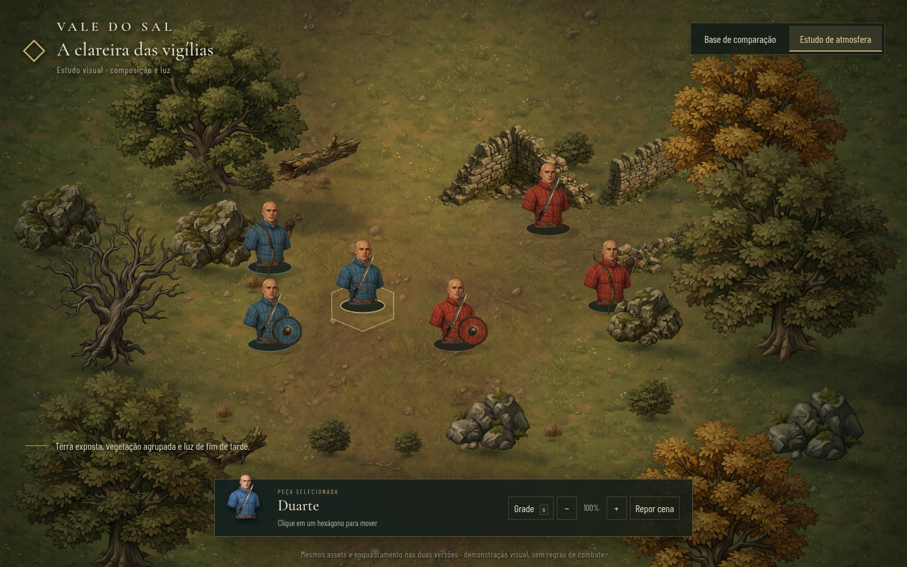
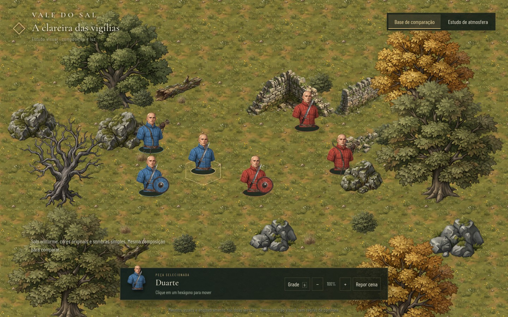

# Estudo visual: A clareira das vigílias

Cena isolada de Phaser para avaliar composição, escala e iluminação antes de alterar o campo de combate. **Não é a arte final nem uma simulação de combate.** Reutiliza os assets pintados do Claude; não houve nova geração, uso de créditos Magnific ou publicação.



## Abrir

```bash
npm ci
npm run dev
```

Abra `/estudo-visual.html` no endereço indicado pelo Vite (normalmente `http://localhost:5173/estudo-visual.html`). A página `/index.html` continua sendo o combate normal. O build também inclui o estudo: `npm run build && npm run preview`.

## Comparar

Os botões superiores alternam entre uma **base controlada de comparação** e o **estudo de atmosfera**, mantendo as mesmas peças, posições, projeção e câmera. A base não reproduz a captura ampla de 42 combatentes: serve para isolar a diferença do tratamento da cena.

- Base: textura uniforme de grama, cores originais e sombra reduzida.
- Estudo: terra exposta no corredor central, massas de vegetação, sombras projetadas das silhuetas, sombras de contato e modulação quente no centro/fria nas bordas.
- Em ambas: seis bustos, bases discretas, um trecho de ruína, rochas e árvores; grade com compressão vertical de 0,72 e sprites verticais sem compressão.



Clique em uma peça e depois no chão para reposicioná-la. A prévia calcula um caminho por vizinhos e evita obstáculos e peças ocupando o destino. Durante a prévia, a opacidade é reduzida apenas quando pixels opacos de um sprite à frente cobrem pontos do caminho. O estudo não usa PA, fadiga, turnos, dano, ordens ou salvamento. Os cliques de movimento apenas demonstram o encaixe visual.

**G** alterna a grade; botões **+ / −** e roda do mouse ajustam o zoom; **Repor cena** restaura as posições e a câmera. O foco é navegador para computador; não foi desenvolvido um sistema de câmera para celular.

## Procedência e isolamento

- Base do trabalho: `main` em `118db09`, com a decisão recente de bustos e iniciativa individual preservadas.
- `public/assets/estudo/`: cópias sem alteração dos arquivos de `public/assets/terreno/` do commit `d3578f8` da branch `claude/project-thread-n1ee01`. Os originais foram gerados no projeto Vale do Sal do Magnific com Nano Banana 2.1 e preparados pelo script do Claude.
- `src/study/pieces.ts`: metadados de proporção/âncora do mesmo commit.
- Bustos: imagens já presentes em `public/assets/bustos/`, preservando as cores de teste azul/vermelho.
- Entrada própria: `estudo-visual.html`, `src/study/main.ts` e CSS exclusivo. O Vite compila ambas as páginas. Nenhum código de combate foi substituído nem a branch inteira de terreno foi incorporada.

## O que este estudo resolve — e o que continua em aberto

Demonstra uma montagem com menos repetição uniforme, aproximação da câmera, espaços mais legíveis e luz compartilhada. **Os contornos e a simplificação das folhas e pedras já fazem parte dos PNGs originais.** O estudo não os transforma em miniaturas realistas nem reproduz integralmente o acabamento das pranchas aprovadas.

O próximo teste de arte deve refazer apenas uma árvore e um conjunto de rochas, com materiais e volumes próximos da referência, verificando-os nesta cena antes de produzir um kit completo. A paleta de facções continua de teste; não há variações de rosto, novos equipamentos, relevo, rampas ou gerador de mapa nesta entrega.

Validação: TypeScript e build; Chromium em 1440×900 e 1024×768; alternância, zoom, grade, movimento, obstáculo e reabertura da página normal de combate. As capturas acima são do próprio navegador, não imagens geradas de uma tela hipotética.
